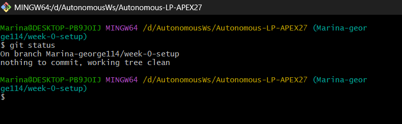
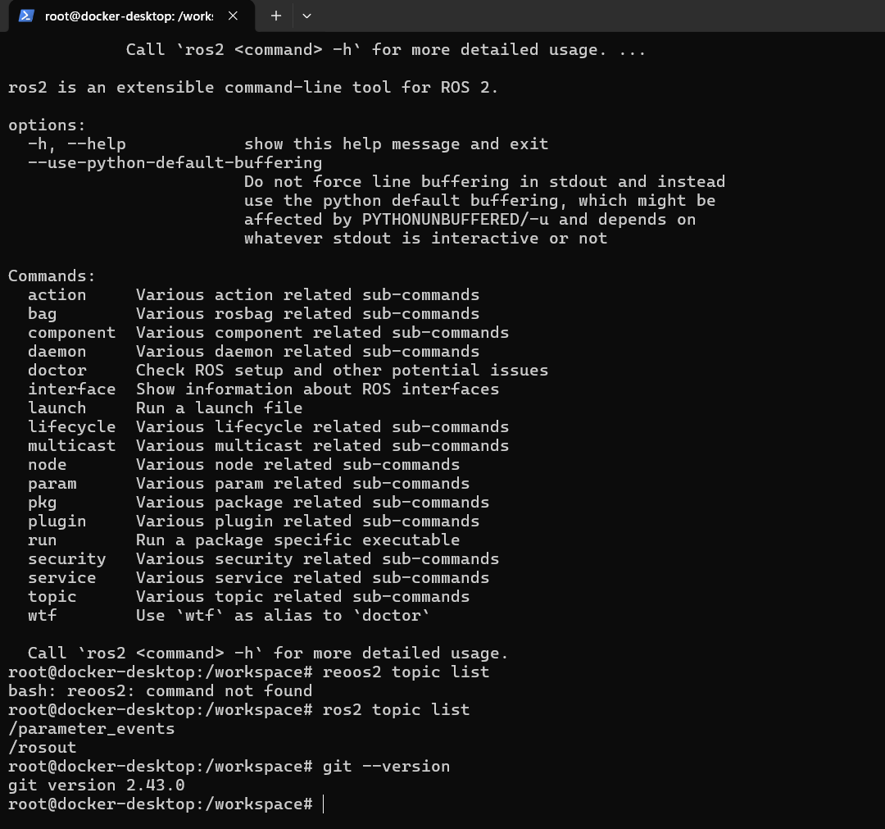
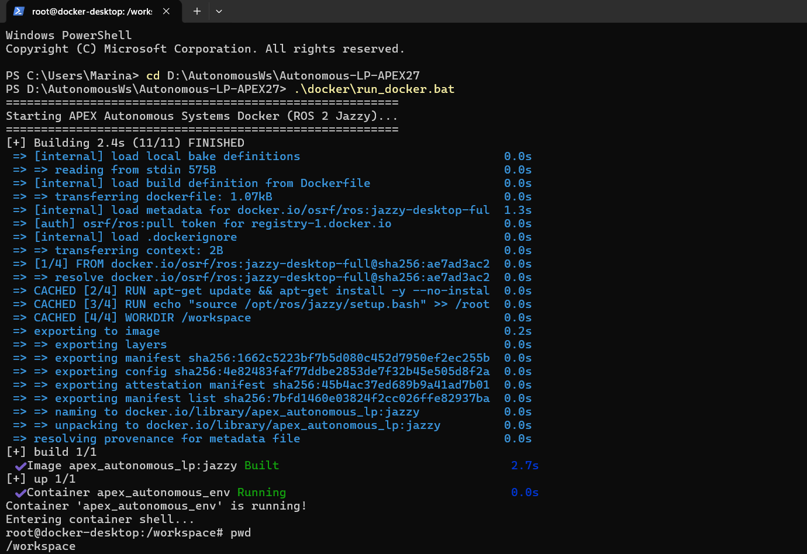
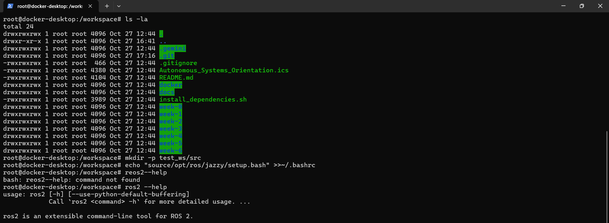

# Week 0 Documentation & Environment Verification Report

**Candidate Name:** Marina George Habib  
**Subsystem Preference:** 1st Choice: ERC Mars Rover | 2nd Choice: Formula Student AI  
**Submission Date:** 2026-10-27  
**Personal Working Branch:** `Marina-george114/week-0-setup`

---

## 1. Workstation & Environment Specifications

| Component | Selected Specification |
| :--- | :--- |
| **Host Operating System** | Windows 11 Pro |
| **Setup Mode** | Docker Sandbox using WSL 2 |
| **ROS 2 Distribution** | ROS 2 Jazzy Jalisco |
| **Docker Desktop Version** | 4.97.0 (244584) |
| **Docker Engine Version** | 29.9.2 |
| **Docker Compose Version** | v5.6.1 |
| **Editor / IDE** | Visual Studio Code |
| **Git Version (Container)** | 2.43.0 |

The development environment was configured using Docker Desktop on Windows 11 Pro with the WSL 2 backend. The project Docker image was built successfully, and the ROS 2 Jazzy environment was verified inside the running container.

---

## 2. Environment Verification Logs & Evidence

### 2.1 Git Branch Status

**Command:**

```bash
git status
```

**Terminal Output:**

```text
On branch Marina-george114/week-0-setup
nothing to commit, working tree clean
```

This confirms that the personal working branch was created successfully and that the working directory was clean at the time of verification.

**Screenshot:**



### 2.2 ROS 2 Core Smoke Test

**Commands:**

```bash
ros2 --help
ros2 topic list
git --version
```

**Observed Results:**

```text
$ ros2 --help

ros2 is an extensible command-line tool for ROS 2.

Commands:
  action
  bag
  component
  daemon
  doctor
  interface
  launch
  lifecycle
  multicast
  node
  param
  pkg
  plugin
  run
  security
  service
  topic
  wtf
```

```text
$ ros2 topic list

/parameter_events
/rosout
```

```text
$ git --version

git version 2.43.0
```

**Verification Summary:**

- ROS 2 CLI executed successfully.
- ROS 2 topics were discovered.
- Git was available inside the Docker environment.
- ROS 2 Jazzy was confirmed using `echo $ROS_DISTRO`.

### 2.3 Verification Screenshots

**ROS 2 Smoke Test:**



**Docker Environment:**



**Linux CLI Practice:**



---

## 3. Debugging & Troubleshooting Log

| Issue Encountered | Root Cause | Diagnosis & Solution |
| :--- | :--- | :--- |
| Docker container was not running when attempting to enter it. | The existing container was stopped. | Started the environment using `run_docker.bat` and confirmed that `apex_autonomous_env` was running. |
| `docker: command not found` inside the container. | Docker management commands were executed inside the Linux container instead of Windows PowerShell. | Used Windows PowerShell for Docker management and the container terminal for Linux and ROS 2 commands. |
| Incorrect ROS 2 command returned `command not found`. | Typing errors such as `reoos2` instead of `ros2`. | Re-executed the correct command and verified that `ros2 topic list` worked. |
| Incorrect ROS 2 setup command was entered in `.bashrc`. | Missing space between `source` and `/opt/ros/jazzy/setup.bash`. | Identified the correct syntax and used a command to remove the incorrect entry and add the correct ROS 2 setup line. |

The troubleshooting process helped distinguish between host-level Docker commands and commands executed inside the Linux container.

---

## 4. AI Interaction & Policy Reflection

> **Note:** AI tools were used as learning and troubleshooting assistants. Commands and results were checked against the actual development environment.

### 4.1 What AI tools did you consult during this week's setup, and what specific queries did you ask?

I used ChatGPT to understand the Docker-based development environment, configure ROS 2 Jazzy, troubleshoot terminal errors, and verify the installation.

Examples of my questions included:

- How do I start and enter the Docker container?
- How can I verify that ROS 2 Jazzy is installed correctly?
- What is the difference between Windows PowerShell and the Linux terminal?
- How can I test ROS 2 communication using Talker and Listener nodes?
- What do the Linux commands `pwd`, `ls -la`, and `mkdir -p` do?
- What screenshots and verification results are required for Week 0?

### 4.2 Did the AI suggest any outdated or invalid commands? How did you verify the correct solution?

Some commands initially failed because they were executed in the wrong terminal or contained typing errors.

For example, Docker commands were attempted inside the container, and an incorrect ROS 2 command was entered.

I verified the correct commands by checking the terminal output, executing `ros2 --help`, confirming the ROS 2 distribution with `echo $ROS_DISTRO`, and successfully listing ROS 2 topics.

I also identified that the project uses ROS 2 Jazzy rather than ROS 2 Humble, so the appropriate setup script is:

```bash
source /opt/ros/jazzy/setup.bash
```

---

## 5. Oral Technical Defense Preparation

### Question 1: Why do professional autonomous racing and rover teams use Docker containers or standardized Ubuntu environments instead of running raw Windows binaries?

Docker provides a consistent development environment with the same dependencies, libraries, and software versions for all team members.

This reduces compatibility problems and makes it easier to reproduce, test, and deploy ROS 2 applications across different computers.

### Question 2: What does the command `source /opt/ros/humble/setup.bash` do inside your Linux shell session, and what happens if you forget to run it?

The command loads the ROS 2 environment variables and configures the shell to locate ROS 2 packages, libraries, and executables.

Without sourcing the environment, ROS 2 commands or packages may not be available in the current terminal session.

Our project uses ROS 2 Jazzy, so the correct command for our environment is:

```bash
source /opt/ros/jazzy/setup.bash
```

### Question 3: What is the difference between working on a dedicated Git branch versus committing directly to `main`?

A dedicated Git branch allows developers to work independently without affecting the stable main branch.

Changes can be reviewed and tested through a Pull Request before being merged into `main`, reducing the risk of introducing errors into the shared project.

---

## Conclusion

The Week 0 development environment was successfully configured using Windows 11 Pro, Docker Desktop, WSL 2, and ROS 2 Jazzy.

Git branch verification, Linux CLI practice, and ROS 2 smoke tests were completed. The environment is ready for the next development tasks, subject to any additional Gazebo verification required by the project mentors.